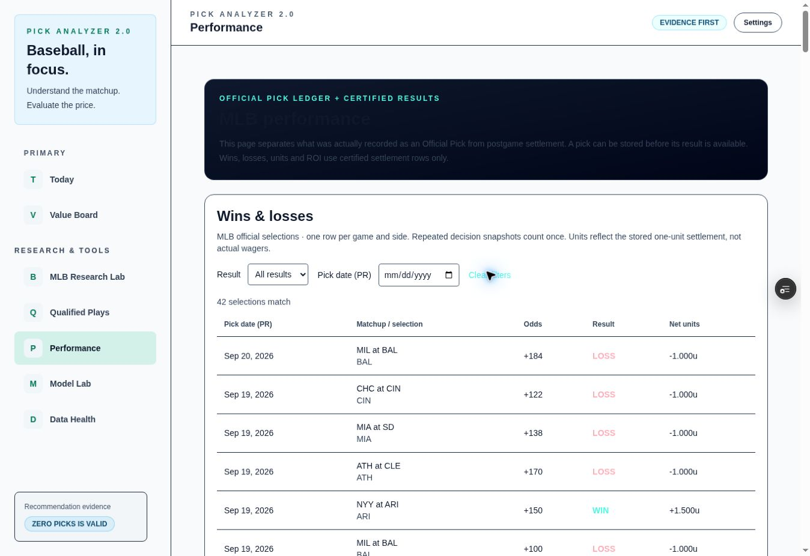
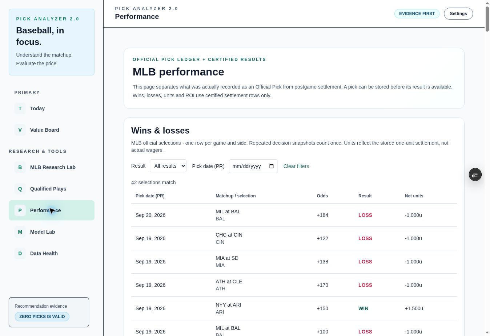

# Desktop review — 2026-10-14

This review keeps mobile and production paused. It does not certify a live forecasting or provider pipeline merely because historical results render correctly.

## Source and metric checks

A read-only independent SQL audit of the Pick Analyzer Supabase project at2026-10-14T20:42:39.250328Z found151 stored Official Pick snapshots and42 unique game/side selections. The109 repeated snapshots do not multiply performance. There are19WIN/23LOSS, zero pending/conflicting groups and zero conflicting or repeated settlement identities. Original-selection net units total3.2609727963087571; display3.261u and one-unit arithmetic return7.8% agree with the ledger. These are hypothetical one-unit returns at original recorded odds, not actual wagers or established future profitability.

The actual Performance page matches those counts. Browser pagination shows25 selections on page1 and17 on page2. SelectingLOSS from page2 resets to page1 and displays23 losses; PENDING returns an empty result. Clear filters restores42 total matches and25 visible rows. Qualified Plays remains separate from official performance and retains its previously verified phase/engine boundaries. The certified projection already collapses executable prices by game/side before producing the current Value Board; the new homepage does not duplicate that ranking/policy logic.

## Navigation and states

- Actual Today homepage retains the official45.2% record and unknown official records for unsupported sports.
- The NHL card opens the NHL Sports Center and correctly reports Preview, blocked production recommendations and no certified production Today/settlement feed. Sports Edge Hub readiness is not imported.
- Value Board loads correctly and shows0 side-level opportunities and1 game awaiting analysis, rather than mislabeling the game as an eligible bet.
- The console sample contained browser-extension metadata errors; none of that sample established an application hydration or module error. This is not a blanket claim that all possible browser errors have been excluded.

## Findings and corrections

1. **Confirmed visual defect:** Performance's light-theme header used a dark gradient with dark text; WIN/LOSS text and reset controls were too faint. The page now uses the existing `mlb-ui` theme scope, and scoped light-mode result colors are darker. Dark-theme colors are unchanged by these light-only selectors.
2. **Basis clarity:** performance labels now say `Net units (1u)` and `ROI (1u)` and explain that returns use one unit per unique official selection and its original stored odds, rather than actual wagering activity. No result, odds, formula or settlement computation was changed.
3. **Open operational dependency:** canonical game849811, scheduled2026-10-15T00:00Z (Oct14,8PM PR), has no champion prediction or stored market observation and zero persisted Official Picks. Direct SQL confirmed the null sources. The Today/Value Board empty states are correct for those inputs. The reason those inputs are absent was not diagnosed here; the intended execution window, runtime and upstream availability must be checked before claiming operational readiness. Absence alone does not prove a cron malfunction. No provider fetch, ingestion run, model promotion or scheduler change was initiated in this review.

The outcome is a reviewed historical dashboard with an explicit current-data dependency, not an unconditional production certification. A positive live daily-card case was covered by deterministic component tests previously; no live positive pick was invented for this review.

## Verification

-23 deterministic logic/render tests PASS after these changes; targeted ESLint PASS.
-The correction is verified in source3047f48a9f415d98abf2ae1236ef931da2a31d7b: Vercel Ready, nine successful GitHub checks, actual desktop browser verification of legible header/result colors and explicit one-unit labels. LOSS resolves to rgb(190,18,60) in the reviewed light theme.
-Mobile checks, merge and production promotion remain out of scope at the owner's request.

## Unedited browser evidence

Before the correction:

After the correction:

Verified preview URL: https://pick-analyzer-git-feat-multisport-official-1ab656-pick-analyzer.vercel.app/performance

The accompanying JSON receipt records the independent SQL counts and current-slate missing inputs. The SQL query is preserved in `desktop-audit-official.sql` and is read-only. No result rows or immutable decision snapshots were changed.

## Build and review closure

The reviewed source3047f48a9f415d98abf2ae1236ef931da2a31d7b has nine successful GitHub checks and a Ready configured Vercel preview. Local webpack PASS(95s) and TypeScript PASS(4.2min); complete local page-data collection is blocked by `Missing NEXT_PUBLIC_SUPABASE_URL` on existing `/api/ai/copilot/chat`. No credentials were fabricated or copied to resolve this environment limitation.

Desktop UI review is PASS for the checked flows and metrics, with the current-slate input dependency explicitly open. Operational readiness is NOT CERTIFIED. Mobile and production remain paused; no main merge, deployment promotion, provider request, database write, model change or scheduler action was performed. The local build has ended and no local task process remains running.
