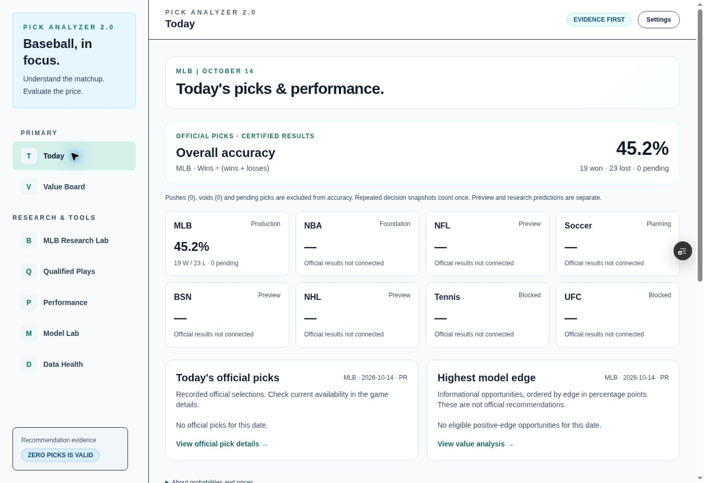
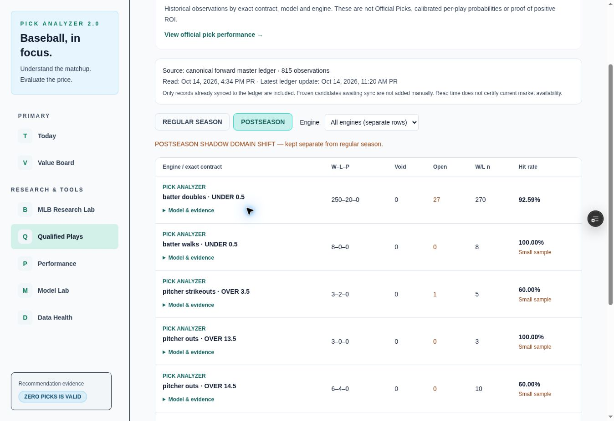

# Pick Analyzer preview verification — 2026-10-14

## Scope

PR #270 remains a draft. No main merge or production promotion was performed. GitHub's existing Vercel integration automatically builds branch previews. Initial functional preview commit: `673bff60793812832dd9830d970c4221ae57738f`. Follow-up table/theme change: `e583ebad33702b2614d37df5fdc856c24f0baf3d`.

## Real browser checks on the functional preview

- `/today` now renders the requested overview and daily sections on the real Pick 2 homepage. The prior `/dashboard`-only integration gap was discovered in browser and corrected.
- Official overall/MLB accuracy is **19W/23L =45.2%**, from42 unique official selections; zero pending, pushes or voids at observation. Other sports show their existing readiness and no invented official record.
- There were zero current Official Picks and zero eligible current positive-edge opportunities for2026-10-14. The existing game slate remained visible and reported waiting for fresh evidence. No informational row was promoted to fill an empty list.
- Performance table showed42 selections; WIN filter returned19; WIN + pick date2026-09-19 returned one row (ARI,+150,+1.500u). A native date edit to2026-09-18 returned zero matches and back to19 returned one. The browser automation's initial fill did not trigger React's date-change handler; native keyboard edits did. No app date-filter failure was demonstrated.
- `/qualified-plays` successfully read and rendered815 actual ledger observations. Postseason Doubles showed250W/20L,27OPEN,n270,92.59%, matching independent SQL and the application verifier.
- REGULAR SEASON + EQUILIZER returned77W/53L,n130,59.23%; no extension of its original cohort.
- REGULAR SEASON + PICK EDGE returned42W/31L,2VOID,n73,57.53%.
- Switching PICK EDGE to POSTSEASON returned the explicit empty state instead of pooling regular evidence or inventing a0% record.
- Returning to POSTSEASON + PICK ANALYZER restored its contract rows and small-sample notices.

## Visual review

Desktop browser access succeeded despite local Playwright Chromium installation being unavailable. The functional preview revealed insufficient light-theme contrast and overly wide research metadata columns. The follow-up change reuses the existing `mlb-ui` light-theme rules, keeps numbers on one line and moves long model/contract/evidence identifiers into accessible details disclosures. Phase and engine controls retain their semantics. Mobile viewport review is still outstanding; no mobile interaction certification is claimed.

The source-ledger SQL parity receipt is separate: `QUALIFIED_PLAYS_READ_VERIFICATION_20261014.json`. It is an atomic read-only snapshot verification, not a profitability certification or a substituted production dataset. Browser result counts are observations at their check times, not guaranteed future counts.

## Final follow-up verification

The e583ebad33702b2614d37df5fdc856c24f0baf3d preview is **Ready** and all nine reported GitHub checks completed successfully. Browser reload confirmed the new six-column layout, all visible numeric counts, current source815 observations and the corrected light-theme presentation. The Doubles model/evidence disclosure was opened and closed successfully. This is desktop preview verification, not a production rollout or mobile certification.

Final local check:23 tests PASS, targeted ESLint PASS, webpack PASS(70s), TypeScript PASS(2.5min). Full local build remains blocked during existing `/api/ai-bet-finder` page-data collection by missing `NEXT_PUBLIC_SUPABASE_URL`. The configured remote preview built successfully; no dummy or real secrets were copied into this environment.

The saved images are the actual browser bytes, without editing or synthetic data:

Verified browser URL: https://pick-analyzer-git-feat-multisport-official-1ab656-pick-analyzer.vercel.app/qualified-plays

No local build, evaluator or ingestion process is left active. Existing external GitHub/Vercel jobs are independent of this chat; no scheduler or provider worker was created or enabled.
